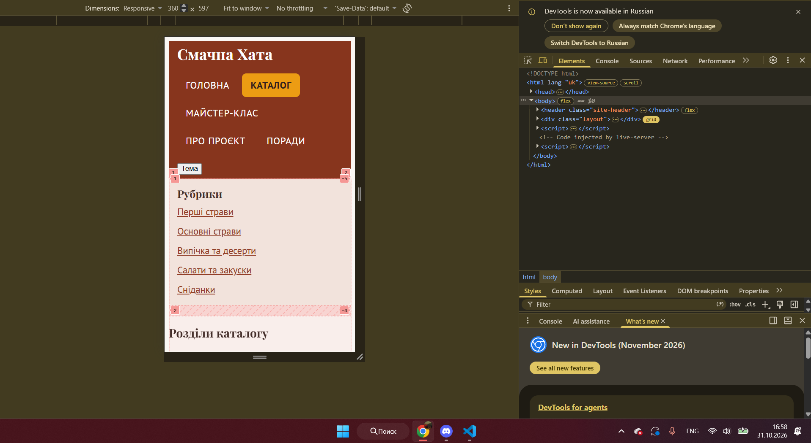
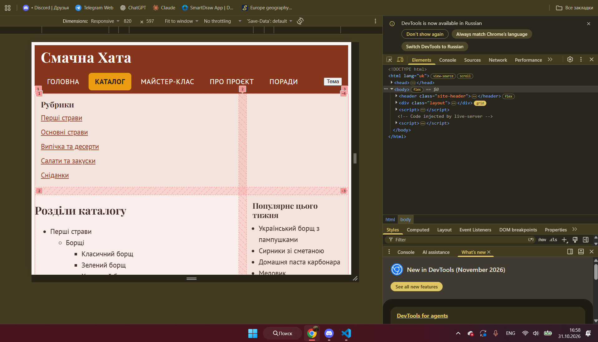
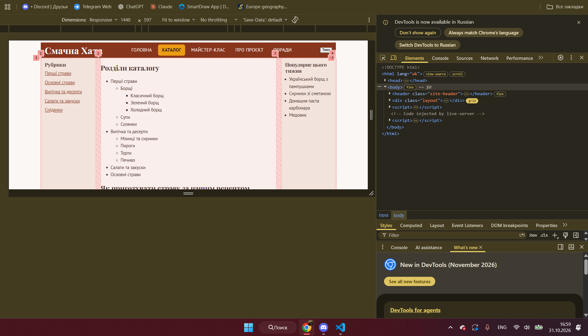

# web-course-2

## Перевірка валідатором W3C

| Сторінка | Errors до | Errors після | Що виправлено |
|---|---|---|---|
| index.html | 0 | 0 | — |
| catalog.html | 0 | 0 | — |
| form.html | 0 | 0 | — |

### Чому клієнтської валідації недостатньо

Клієнтська валідація (атрибути `required`, `pattern`, `min`, `max` тощо) працює лише в браузері
користувача і легко обходиться. У DevTools я відкрив панель Elements, видалив атрибут `required`
з поля електронної пошти прямо в «живому» DOM — і порожня форма одразу відправилась без жодної
помилки. Після оновлення сторінки (F5) атрибут повернувся, бо файл `form.html` на диску я не
змінював: браузер просто заново завантажив оригінальний код. Це доводить, що клієнтська перевірка
контролює лише інтерфейс, а не сам сервер, і будь-хто технічно підкований може її вимкнути чи
обійти. Тому остаточно перевіряти й фільтрувати дані, що надійшли від користувача, зобов'язаний
сервер (backend) — саме йому не можна довіряти жодним даним із форми без повторної валідації.

## Оформлення

**Шрифти (Google Fonts):**
- Заголовки — [Playfair Display](https://fonts.google.com/specimen/Playfair+Display)
- Основний текст — [PT Sans](https://fonts.google.com/specimen/PT+Sans)

**Палітра (custom properties):**

| Змінна | Значення | Призначення |
|---|---|---|
| `--color-brand` | теракотовий | шапка, заголовки, акценти таблиці |
| `--color-accent` | медово-гірчичний | кнопки, hover, підсвітка |
| `--color-bg` | кремовий | фон сторінки |
| `--color-surface` | світло-бежевий | фон карток, зебра таблиці |
| `--color-text` | темно-коричневий | основний текст |
| `--color-muted` | приглушений сірувато-коричневий | другорядний текст, рамки |
| `--radius` | 0.5rem | заокруглення кутів |
| `--space` | 1rem | базовий відступ |
| `--shadow` | тінь картки | box-shadow для article |
| `--font-heading` | Playfair Display | шрифт заголовків |
| `--font-body` | PT Sans | шрифт основного тексту |

Найскладнішим виявився псевдоклас `:has()` для автоматичної зірочки на обов'язкових
полях форми — довелось розібратись, як він перевіряє не прямих дітей, а сусідні
елементи через `~`, і що ним взагалі можна замінити правки в розмітці. Також не одразу
вдалось вирівняти числові колонки в таблиці через `rowspan`, поки не спробував рахувати
позицію комірки з кінця рядка (`nth-last-child`) замість початку.

## object-fit

- При `fill` картинка розтягується під розмір блока, пропорції ламаються: вертикальні сирники стали приплюснутими.
- При `contain` картинка вміщається цілком, тому по боках або зверху й знизу лишаються порожні поля.
- При `cover` блок заповнений повністю, але частина картинки по краях обрізається.

## Три крапки

- Без `white-space: nowrap` назва переноситься на кілька рядків, і обрізати нічого.
- Без `overflow: hidden` довга назва вилазить за рамку картки.
- Без `text-overflow: ellipsis` текст просто різко обрізається, без трьох крапок.

## Схлопування відступів

Вертикальні відступи сусідніх блоків не додаються, а зливаються в один, більший з двох, тому 24px і 16px дають 24px, а не 40px. Горизонтальні відступи завжди додаються. Щоб із цим не стикатись, я задаю вертикальні відступи тільки в один бік, знизу.

## Адаптивна сітка

Під час зміни ширини вікна каталог перебудовується приблизно так: з чотирьох колонок у три близько 1516px, з трьох у дві близько 1256px, з двох в одну близько 996px.

Медіазапитів у CSS немає. Браузер сам рахує, скільки колонок завширшки щонайменше 240px (`--min-col`) разом із проміжками вміщається в контейнер, а залишок ділить порівну завдяки `1fr` у `repeat(auto-fit, minmax(var(--min-col), 1fr))`.

Різниця між `auto-fit` і `auto-fill`: коли карток мало, `auto-fill` лишає порожні колонки, і картки зсуваються ліворуч, а `auto-fit` стискає порожні колонки до нуля, і дві картки розтягуються на весь рядок.

## Areas

Коли я поміняв місцями слова `nav` і `side` у `grid-template-areas`, колонки помінялися місцями без жодної правки HTML. Це доводить, що розмітка відповідає лише за зміст і порядок для читалок, а розташування на екрані окремо задає CSS.

## Sticky і Grid

Липкий елемент може «їздити» лише в межах свого контейнера. Якщо занести `<header>` усередину `.layout`, його контейнером стане грид-область з одного короткого рядка сітки, їздити йому нікуди, і липкість зникає. Тому `<header>` лишається за межами `.layout`, і на всіх сторінках шапка прилипає.

## dialog

- Вікно закривається клавішею Esc.
- Поки вікно відкрите, сторінка позаду не прокручується (це робить правило з `body:has(dialog[open])`).
- Затемнення тла я окремим елементом не створював, його намалював псевдоелемент `::backdrop`.

## Скріншот сітки

### Телефон (360px)

Одна колонка: шапка, рубрики, каталог, aside, футер. Меню складене в кнопку «☰ Меню», у каталозі одна картка в ряд.

### Планшет (820px)

Рубрики зверху на всю ширину, нижче каталог ліворуч і aside праворуч. Меню розгорнуте в ряд, шапка липка, у каталозі дві картки в ряд.

### Десктоп (1440px)

Три колонки: рубрики ліворуч, каталог посередині, aside праворуч. У каталозі три картки в ряд, ширина макета обмежена 1200px і він стоїть по центру.

## Меню без JS

`
` кращий за «чекбокс-трюк» з `:checked`, бо це справжній елемент браузера: він сам відкривається й закривається, працює з клавіатури (Tab, Enter, Пробіл) і читалки розуміють, що це розкривний блок. Трюк із прихованим чекбоксом треба підтримувати вручну і він плутає читалки. Коли в темі 9 меню буде на JavaScript, за відкриття й закриття відповідатиме код, і можна буде додати закриття по кліку за межами меню або по Esc.

## Що анімуємо

Анімуємо лише `transform`, `opacity`, `box-shadow` і кольори. `transform: translateY(-6px)` дешевший за `top: -6px`, бо зміна `top` змушує браузер заново рахувати геометрію (Layout), потім перемальовувати (Paint) і збирати шари (Composite). А `transform` зазвичай виконується лише на останньому кроці, Composite, тому картка рухається плавно й не чіпає сусідні елементи.

## Reduced motion

Рух на екрані шкодить людям із вестибулярними порушеннями й мігренню: від анімацій у них паморочиться голова. Тому в блоці `prefers-reduced-motion: reduce` я не вимикаю анімації, а роблю їх майже миттєвими (0.01ms): так події завершення анімації все одно спрацюють і нічого не зламається. Картка замість підйому лишає відгук у вигляді жовтої рамки. `!important` тут виправданий, бо правило має перебити тривалість у будь-якому компоненті, а перелічувати їх усі було б неможливо. Спінер без руху лишається зрозумілим завдяки тексту «Завантажуємо каталог…».

## Дані варіанта

Дані сайту про рецепти я описав як масив `recipes` із шести об’єктів. У кожного є `id`, `title`, два числові поля (`minutes` — час приготування і `calories`), `category`, вкладений об’єкт `details` (код рецепта `code` і складність `difficulty`) та масив `tags`. Вкладений об’єкт зручний, коли кілька дрібних відомостей стосуються одного запису: до них звертаємось через крапку, наприклад `recipe.details.code`. Масив `tags` зберігає список ярликів різної довжини.

## Функція show

- `box === null` написано строго, бо `getElementById` повертає саме `null`, коли елемента немає. Строге порівняння перевіряє рівно те, що ми очікуємо, а `== null` пропустило б ще й `undefined`.
- На практиці перевірка спрацює, коли в виклику `show` помилка в `id`, коли такого елемента немає в розмітці або коли скрипт виконався раніше за розмітку (без `defer`).
- `Array.isArray()` потрібен, бо `typeof` для масиву дає `"object"`, так само як для звичайного об’єкта, тож відрізнити їх через `typeof` не можна.

Якщо передати в `show` об’єкт статистики цілком, на сторінці буде `[object Object]`: у `textContent` об’єкт перетворюється на рядок, а в звичайного об’єкта рядкове подання саме таке. Тому я виводжу поля об’єкта окремо.

## Вибір запису функцій

Функцію `categoryOf` я оголосив через `function`: це окрема самостійна функція-довідник, яку зручно викликати з будь-якого місця, бо оголошення `function` піднімається нагору файлу (hoisting). Для коротких обробників (`show`, `filterBy…`, `sortBy…`) вистачає стрілкових функцій з одним виразом.

## sort без компаратора

Без компаратора `sort()` перетворює елементи на рядки й порівнює їх посимвольно. Тому `[10, 9, 100, 1].sort()` дасть `[1, 10, 100, 9]`: рядок `"1"` менший за `"10"`, той менший за `"100"`, а `"9"` більший за всі. Компаратор `(a, b) => a - b` порівнює саме числа.

## Три помилки

1. Зіпсований `id` у `show`: у консолі `Немає елемента з id: out-statz` (моє повідомлення). Без перевірки на `null` було б `TypeError: Cannot set properties of null (setting 'textContent')`. Причина: `getElementById` не знайшов елемент і повернув `null`.
2. Без `defer`: у консолі повідомлення `Немає елемента з id: …` для кожного виклику `show`, блоки порожні. Причина: скрипт у `<head>` виконався раніше, ніж браузер розібрав розмітку, тож елементів ще не існувало.
3. Одруківка `r.titl`: помилки не було, на сторінці з’явилося `undefined`. Причина: звернення до неіснуючого поля об’єкта не помилка, а просто `undefined`.

У цій роботі змінювався лише `catalog.html`; `index.html` і `form.html` не чіпали.

## Що вміє каталог

Картки каталогу більше не прописані в HTML: функція `renderCards` будує їх із масиву `recipes` через `createElement` і `textContent` і дає їм ті самі класи, що були в статичних. Пошук і список категорій перемальовують сітку на льоту: пошук реагує на кожен введений символ, а категорію відбирає функція `filterByCategory` з ЛР8. Якщо нічого не знайдено, з’являється повідомлення. Клік по картці відкриває модальне вікно з даними саме цього рецепта.

## Делегування

Обробник кліку висить один, на контейнері `#cards`, а не на кнопках у картках. Подія «спливає» від кнопки вгору, тому контейнер бачить кліки і по картках, створених після перемальовування (пошук чи фільтр). Через `event.target.closest(".card")` я знаходжу картку, а за `data-id` потрібний об’єкт у масиві. Слухачі на самих кнопках зникали б разом зі старими картками після кожного `renderCards`.

## Меню

Кнопка `<button>` з `aria-expanded` і `aria-controls` це справжній елемент керування: читалка озвучує, що меню згорнуте чи розгорнуте, а я можу закривати його ще й по Esc і кліку поза меню. `
` з ЛР7 теж працює без JavaScript, але закрити його ззовні не можна, а «чекбокс-трюк» підміняє меню прихованим прапорцем, який читалка озвучує неправильно.

## Тема

Одного класу `.dark-theme` мало: він лише вмикає темну тему, а коли система сама темна, користувач не міг би примусити світлу. Тому на кореневому елементі є два класи-перебивачі, `.dark-theme` і `.light-theme`. Без жодного з них діє системна схема з `prefers-color-scheme`.

## Безпека

Самоатака: у полі пошуку й у коментарі форми я ввів ``. У квитанції рядок показався як звичайний текст, вікно не вискочило, консоль чиста. Назва з кутовими дужками в даних теж показується буквально. Вразливостей не знайшов. Правило: усе, що приходить із масиву, форми чи поля вводу, потрапляє на сторінку лише через `textContent` або `createElement` + `textContent`, бо `innerHTML` розбирає рядок як розмітку, і чужий `onerror` виконався б. У `app.js` слова innerHTML немає.

## Перевірка валідатором W3C

|   Сторінка   | Errors до | Errors після | Що виправлено |
|--------------|-----------|--------------|---------------|
| index.html   |     0     |       0      |       —       |
| catalog.html |     0     |       0      |       —       |
| form.html    |     0     |       0      |       —       |